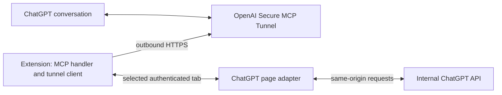

<p align="center"></p>

Organize your ChatGPT conversations by talking to ChatGPT.

> “Find my recent chats about the Dolomites. Read them, connect the itinerary and gear decisions, and propose clearer titles and project groupings. Show your reasoning before changing anything.”

ChatGPT does the reasoning across conversation contents. Chat Commander supplies tools to discover and read chats, prepare an exact proposal, and carry out confirmed operations. You do not need to collect conversation links when discovery succeeds.

**Experimental · 0.12.2 · Firefox desktop 140+ · MIT.** Requires your own private OpenAI Secure MCP Tunnel, a dedicated runtime key, a custom ChatGPT app connection and an authenticated personal ChatGPT tab. Installation does not provide access to these services. Not affiliated with OpenAI or Mozilla.

## See the workflow

The demo found three conversations among the ten most recent chats, read their active-branch text, connected hiking itinerary choices to gear and spending, and kept interview preparation separate. No manual conversation links were needed and no changes were applied.

<details><summary>Discovery and content-grounded reasoning</summary>

</details>

<details><summary>Exact preview before confirmation</summary>

</details>

<details><summary>Connection setup, one step at a time</summary>

</details>

These are actual disposable-data browser captures, not mockups. A prepared proposal does not authorize execution. The host's developer-mode badge in the confirmation capture is not an extension setting; the extension does not relax page security headers or its declared CSP.

## What it does

- List recent non-archived chats and search titles/messages with pagination.
- Read bounded active-branch text and continue through long conversations.
- Rename, archive and restore individual chats using current-state checks.
- Review up to 20 chats and prepare evidence-based title/archive suggestions and optional groups.
- List projects; prepare empty project creation, individual moves and permanent single-chat deletion.
- Require in-chat confirmation for project creation, moves, deletion and multi-chat review plans. Stop on conflicts or uncertain results; never automatically retry mutations.

Groups are suggestions, not automatic project creation or moves. Project deletion, bulk deletion, project instruction/file editing and rollback are not supported. A conversation open in the connected source tab is protected from review, moves and deletion. Permanent deletion has no extension undo.

## How it works



The extension runs its tool handler and outbound tunnel client in the browser. No separately installed daemon, developer-operated backend or conversation database. The desktop browser must remain running.

The ChatGPT session token stays inside the page. Requested chat titles, links, text excerpts, project metadata and operation results travel through OpenAI so ChatGPT can respond. **Local execution does not mean no data transmission.** There is no analytics or persistent conversation cache. Optional password encryption stores the tunnel runtime key on this device; the password is not saved. See [privacy](extension/privacy.html) and [security](SECURITY.md).

The tunnel must stay private to its owner. The extension does not authenticate distinct users sharing a tunnel and is not intended as a multiuser service.

## Install and connect

The public Mozilla submission for 0.12.2 has been sent; a live public listing has not yet been confirmed. Earlier versions were signed for self-distribution. Use a Mozilla-signed XPI for a stable Firefox installation. Local ZIP builds are unsigned and do not bypass signing requirements.

For development:

```sh
python3 scripts/build_firefox.py
```

Temporarily load `dist/firefox/manifest.json` in `about:debugging#/runtime/this-firefox`. Firefox removes temporary installations on full browser exit.

Open settings and follow three numbered steps: prepare/unlock the key, explicitly connect your personal ChatGPT tab, then configure/refresh the ChatGPT app and try a read-only request. Settings and the confirmation component support English and Italian, with English fallback. [Detailed setup](docs/connection-setup.md).

## Development

Node.js 22+ for tests; Python 3 standard library for packaging. No npm install or runtime library dependency is required.

```sh
npm test
python3 scripts/package_firefox.py
```

Packaging produces a deterministic unsigned Firefox ZIP, a reproducible source ZIP and SHA-256 files in `dist/`. Checked-in icons are release inputs. Regenerating them from the original owner-supplied PNG requires Pillow; ordinary packaging does not. CI runs the tests and build; hosted CI results must be checked after pushing.

## Evidence and limits

125 automated tests pass locally. The author verified listing/search/read, reversible chat actions, project creation/moves, an independently verified disposable deletion, encrypted-key restart/unlock, permission revocation/recovery, guided settings and English confirmation previews in desktop Firefox. [Current evidence](docs/status.md).

Earlier intermittent discovery and deletion failures remain unexplained. A successful later run does not establish a root-cause fix. Recent keyword search can miss relevant conversations; listing recent candidates and reading them is an alternative, not a guarantee of exhaustive discovery. Undocumented ChatGPT endpoints may change. Non-text attachments are not interpreted. Inaccessibility after deletion does not certify physical erasure from OpenAI systems.

Android and Chromium functionality, exhaustive search coverage and prolonged lifecycle behavior are unverified. A real second-account browser test was skipped; automatic identity-refusal tests pass. Automated tests and Mozilla signing are not an independent security audit. This private-tunnel architecture does not supply a public OpenAI plugin-directory endpoint.

[Architecture](docs/architecture.md) · [Design decisions](docs/decisions/006-consolidation.md) · [Manual review checks](docs/review-setup.md) · [Conversational test suite](docs/conversational-tests.md)

Support: sbaginov@yahoo.it. Do not include credentials, cookies, HAR files or private conversations in reports. Licensed under the [MIT License](LICENSE).
