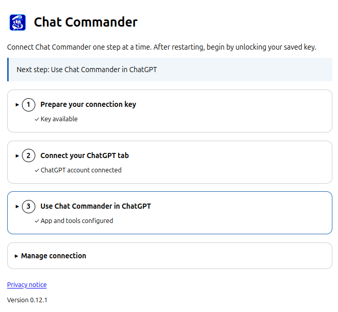

# Connect Chat Commander

This is a personal developer integration. Installation does not create an OpenAI tunnel, grant Platform roles or enable custom MCP connections in ChatGPT. Do not start by buying a plan based on this project: eligibility depends on your account/workspace and must be checked in OpenAI’s current UI.

## 1. Prepare your private tunnel

Follow the [official Secure MCP Tunnel guide](https://developers.openai.com/api/docs/guides/secure-mcp-tunnels). Creating/managing a tunnel requires Tunnels Read + Manage; running/selecting it requires Read + Use. Platform organization permissions and ChatGPT workspace permissions are separate. Use a tunnel associated with your target personal ChatGPT workspace.

Create a dedicated runtime key with only the required tunnel access. Save the tunnel ID and runtime key locally. Never use an Admin key in the extension. This extension contains the tunnel client and MCP handler: do not run another client against a local server for this setup.

In extension settings, expand **1 — Prepare your connection key**. Enter the tunnel ID/key, optionally save encrypted with a local password (12+ characters), then save. Feedback appears immediately below the form. A saved key alone does not pair a tab or prove ChatGPT can call tools.

## 2. Pair a personal ChatGPT tab

Open ChatGPT and sign in using a personal account/profile. Wait for the page to load. In **2 — Connect your ChatGPT tab**, allow the requested access and select the intended tab if more than one is available. Press **Connect selected tab**. Its title and result appear in the same step. Keep it open; the chat currently displayed in it is protected from review and writes.

This is a real older capture of the numbered layout. In 0.13 the last step reports observed traffic instead of a manual acknowledgement. It is not evidence that 0.13 has passed authenticated browser testing.

## 3. Connect the custom MCP app in ChatGPT

Use the [official custom MCP setup](https://developers.openai.com/api/docs/guides/custom-mcp-server). Current menu names can vary. If your UI requires developer mode, enable it in the supported workspace settings first; if unavailable, stop and check account/workspace eligibility rather than changing extension permissions.

1. Open ChatGPT **Plugins/Apps**, select **+**, then **Add custom MCP server** (older developer-mode UI: **Create app**).
2. Name it **Chat Commander**.
3. Under **Connection**, choose **Tunnel** and select/paste the same tunnel ID. This is not a public `/mcp` URL. If absent, check workspace association and Tunnels Read + Use.
4. For this private personal server, choose **No authentication** for app-level authentication. The extension has no OAuth server. The runtime key authenticates the extension to OpenAI; never paste it into the ChatGPT conversation or the app’s OAuth fields. Keep app/tunnel access private to you.
5. Review the risk warning and create the connection. Anyone with access to this workspace app/tunnel may be able to call its tools against your paired history. Do not publish or share the connection.
6. Open its management page and use **Refresh tools** after a catalog update. Version 0.13.2 also accepts null for new-project destinations and returns field-specific validation errors. After loading it, refresh tools, verify prepare_project_plan is listed and enabled, then start a NEW conversation and select Chat Commander again. Extension reload alone is insufficient. Do not recreate the app on every browser restart.
7. In a new command conversation, enable/select **Chat Commander** and send:

   > Use Chat Commander to list my 3 most recent chats. Do not modify anything.

The returned list or error appears in the conversation. Extension step 3 now shows when ChatGPT fetched the current catalog and when a tool call succeeded. No self-attestation button can mark setup complete. Catalog fetched/successful-call feedback confirms server traffic, not that the current conversation enabled every advertised tool. Successful polling alone verifies tunnel access, not tool execution. This evidence is session-local; after restart/unlock invoke a read again.

The fields above are a textual walkthrough, not invented screenshots of ChatGPT. Fresh redacted captures of the host’s current connection form are still needed before a polished public launch; do not include keys or personal chats in them.

## Restart and recovery

After restart unlock the encrypted key, open the authenticated personal tab and wait for same-account reconnect. If it fails, repeat step 2. Saved passwords are not ChatGPT passwords. Missing permissions and different identities never silently establish new trust.

If a card is reopened, wait for its live report. A partial batch offers **Resume remaining operations**; terminal, expired and superseded cards cannot authorize writes. After an uncertain result inspect `get_review` and native ChatGPT state; never repeat the mutation automatically. Reconnecting revokes approvals while retaining read-only reports for the same account until expiry/capacity eviction. A worker restart loses volatile reports; disconnect/forget explicitly purges them.

For schema drift, use **1 → Key and tunnel checks → Check ChatGPT read contracts**. It reads a recent-chat page, a bounded conversation sample and the first owned-project page; the displayed report contains only check names/codes. It sends no writes, records no raw contents and stops on the first failure. This is not a full live contract certification.

Use a Mozilla-signed XPI for stable Firefox installs. Temporary `about:debugging` loads disappear on browser exit. Android is not declared compatible. Never send HAR files, cookies, keys or real chat contents for support.

Retained report access revalidates the live session identity; if the session cannot be verified, reconnect the same account before reading the report.

For the 50-chat demo, use the [preflight-first prompt](demo-prompt.md). A read result’s server_info states the running version, catalog and limits; if that differs from the callable tools, refresh the app and use a new conversation before continuing.
